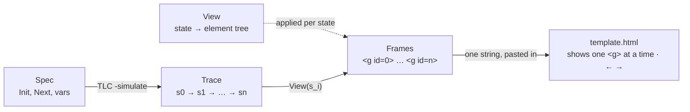
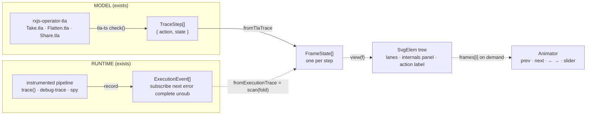

# RxJS Trace Viewer

`rxjs-trace-viewer`: one frame per state, adapting the TLA+ Animation module to an
RxJS state tracing animation tool.

This repository holds the design note that came out of reading Will Schultz's
[tlaplus_animation](https://github.com/will62794/tlaplus_animation) module and his
2018 talk, and asking whether the same idea works for RxJS. The answer is yes, and
most of the parts already exist in sibling repositories.

- Design page with diagrams: [`docs/index.html`](docs/index.html)
- Published copy as a Claude artifact (private link): https://claude.ai/code/artifact/cd46e489-ca69-4f56-9dcc-03461be6889e
- The same content in Markdown: this file
- The gallery of every animation, model and runtime, as a Claude artifact (private link): https://claude.ai/code/artifact/8d87eb3c-d2cb-4303-b981-65a6687d59b0

This repository is also where the prototype lives: an **RxJS Trace Viewer**
built on the one-frame-per-state idea. Milestones M1 (SVG frames over
tla-ts traces), M2 (the package), M3 (the runtime adapter) and M4 (the
components) are done; see
[Prototype](#prototype). The gallery of every animation, model and runtime,
is `out/gallery.html`.

## Prototype

The prototype runs on Node 24 with no build step (Node strips the types
itself); `npm run build` emits `dist/` with type declarations for consumers.
Checking needs a checkout of
[rxjs-operator-tla](https://github.com/hansschenker/rxjs-operator-tla) next
to this repository, or `--specs <dir>` pointing at its `specs` folder.

```bash
npm install
npm run animate                                   # the four bug demos, from the specs
npm run animate -- Take.cfg Pipeline.cfg          # any configs from the manifest
npm run animate -- --specs ../rxjs-operator-tla/specs
npm run render:runtime                            # the recorded runs under traces/runtime
npm run gallery                                   # every animation on one page: out/gallery.html
npm run verify                                    # format, typecheck, test, build, all of the above
```

The recordings under `traces/runtime` are committed. To record them again,
or to add scenarios, a built checkout of
[rxjs-execution-debugger](https://github.com/hansschenker/rxjs-execution-debugger)
next to this repository is needed:

```bash
npm run record:runtime -- --debugger ../rxjs-execution-debugger
```

`animate` checks each config with tla-ts, writes the counterexample to
`traces/<cfg>.json`, folds it into one `FrameState` per state, renders one
SVG frame per state, and writes a playback page to `out/<cfg>.html`. Open
the page in a browser: Prev / Next, ← →, Home / End, Space to play, or
click a step in the list. `trace` and `render` run the two halves alone.

| File | Role |
|---|---|
| `src/index.ts` | the core entry, `rxjs-trace-viewer`: browser-safe, no Node or tla-ts |
| `src/tla.ts` | the checking entry, `rxjs-trace-viewer/tla`: Node and tla-ts |
| `src/values.ts` | `JsValue`, a TLA+ value as plain JavaScript |
| `src/trace-file.ts` | `TraceFile`, the shape of `traces/<cfg>.json` |
| `src/trace.ts` | `runTrace`: tla-ts `check()` to a `TraceFile`, VARIABLES in declaration order |
| `src/tla-values.ts` | `toJs`, tla-ts values to `JsValue` |
| `src/frames.ts` | `FrameState` and the model adapter `fromTlaTrace` |
| `src/execution-trace.ts` | `ExecutionTrace`, the exported log of rxjs-execution-debugger, declared here |
| `src/runtime.ts` | the runtime adapter `fromExecutionTrace`: the fold from events to frames |
| `src/view.ts` | the View: `buildTimeline`, `layoutFor`, `renderFrame` |
| `src/svg.ts` | `SvgElem` records and `serialize`, after `SVGElem` and `SVGElemToString` in Animation.tla |
| `src/animate.ts` | the playback page and the gallery, after `template.html` |
| `src/render.ts` | `renderTrace`, `renderExecutionTrace`: a trace to frames and page in one call |
| `src/cli.ts`, `src/cli-args.ts` | `trace`, `render`, `animate`, `render-runtime`, `gallery` |
| `scripts/record-runtime.mjs` | records the runtime scenarios through the debugger's `trace()` under virtual time |
| `test/` | unit tests on synthetic traces, fixture tests on the demos and recordings, page, gallery and CLI tests |
| `traces/` | the four demo counterexamples and, under `runtime/`, six recorded runs |
| `out/` | the generated animations and the gallery |

### Runtime traces

`fromExecutionTrace` is the fold the design note promised. The debugger's
log is a list of events, not states, so each event is applied to the state
after the previous one: subscribe turns a lane on, next appends a value,
complete and error end it, unsubscribe with reason cancel turns it off. One
lane per subscription, named by its trace label and numbered when a label
is subscribed more than once (`inner[1]`, `inner[2]`); a subscription with a
parent is placed right after it. The recording's `labels` give the display
order, as a spec's VARIABLES do for the model side. Columns are the
distinct event times, labelled in milliseconds. The panel shows which
lanes are currently subscribed, which is what makes the shareReplay leak
visible at a glance.

The six recordings mirror the model demos and add the two contrasts:
mergeMap against switchMap, and shareReplay against share. Where the model
knows more than the runtime, the animation says so: the concatMap stall
shows the queued inner as `pending` on the model side and not at all on
the runtime side, because an inner that is never subscribed produces no
events.

### Package

Two entry points, so a page can render frames without the checker:

```ts
import { runTrace } from "rxjs-trace-viewer/tla"; // Node + tla-ts: check a config
import { renderTrace, fromTlaTrace } from "rxjs-trace-viewer"; // browser-safe

const file = await runTrace("../rxjs-operator-tla/specs", "Flatten_bug_mergeForSwitch.cfg");
const { html, frames, set } = renderTrace(file); // page, SVG frames, FrameState[]
const frameSet = fromTlaTrace(file); // only the adapter
```

`renderTrace` returns the `FrameSet`, the `Timeline` of marks, the shared
`Layout`, one `SvgElem` per frame and the page. The lower-level pieces
(`buildTimeline`, `layoutFor`, `renderFrame`, `serialize`,
`renderAnimationHtml`) are exported too, for a component that renders one
frame on demand (milestone M4).

How a frame is built from a state, by the conventions of the specs:

- A sequence variable that only ever grows by appending is a stream lane,
  with `<name>Done` as its status. A sliding buffer is not append-only and
  stays in the panel.
- A function to append-only sequences, such as `received[s]`, is one lane
  per key; `sub[s]` puts subscribe (`^`) and unsubscribe (`!`) on that lane.
- A sequence of records, such as Flatten's `inner`, is one lane per element;
  a pill shows the element's new `state`, or the fields that moved
  (`sent=1`).
- Every other variable is printed verbatim in the panel and highlighted in
  the step that changed it.
- A liveness counterexample shows where the trace loops.
- The lane order is the spec's VARIABLES order; the column is the step, or
  `now` when the spec has logical time.

Known limits of M1: frames are pre-rendered as hidden groups, which suits
counterexamples but not long runtime traces; tla-ts reports an action
without its arguments, so a step says `InnerNext` rather than
`InnerNext(1)`, and the ring on the lane that moved stands in for it.

> **Verdict.** A trace is a sequence of states. A view is a pure function from a
> state to a picture. An animation is one frame per state. That is the entire idea
> behind the Animation module, and it transfers to RxJS one to one, because the
> operator specs and runtime tracers in this account already treat an Observable
> as a state machine. The model side is nearly free; the runtime side needs one
> `scan` fold from events to per-step snapshots.

### Components

`mountTraceViewer(container, frameSet, options)` is the viewer as a DOM
component: the controls of the playback page, with the current frame
rendered on demand into one `<svg>` by `createFrameRenderer`, and a
`createPlayer` state machine behind Prev, Next, Play, the slider, the step
list and the keyboard. It is framework-less, so the two design-system
components are thin wrappers:

- `TraceViewer` in rxjs-ds, written in framework-less JSX against a small
  DOM `jsx-runtime` (the first non-React component there; the
  claude.ai/design sync still renders exports as React stories and cannot
  show it).
- `RTraceViewer` in rxjs-vitepress-ds, registered globally, so a page can
  write `<RTraceViewer src="/traces/Flatten_bug_mergeForSwitch.json" />`.
  Its styles remap the `--rtv-*` tokens to the VitePress theme, dark mode
  included.

Both take a `trace` object or a `src` URL, and `title`, `subtitle`, `note`,
`steps` and `interval`. `toFrameSet` accepts a trace file, a recording or a
frame set; `traceText` supplies the default title, subtitle and note.

## What the Animation module does

`Animation.tla` is 170 lines. It defines SVG primitives as records of the shape
`[name, attrs, children]`: `Line`, `Circle`, `Rect`, `Text`, `Group`. A user writes
a **View**, an ordinary state expression over the spec's variables that returns one
element tree. Two wrappers, `AnimatedInit` and `AnimatedNext`, add three auxiliary
variables: a running SVG string, a frame counter and an optional action name. On
every step the wrapper evaluates View in the new state, serialises it, and appends
it. The last state of a TLC error trace therefore contains every frame.

Playback is a static HTML template. Each frame is a top-level `<g>` inside one
`<svg>`; the page shows one group at a time, driven by Prev and Next buttons and
the arrow keys. Every frame carries a `Next Action` label.



Three facts in the code matter for the adaptation.

- **The frame contract is trivial.** Any sequence of top-level groups inside one
  SVG is an animation. The newer template takes first-level children in order.
- **Action names are a hack in the original.** The author must write
  `Next /\ ActionName("MoveElevator")` per disjunct. TLC's trace explorer and
  tla-ts both report the action per step for free.
- **The author retired the string-building design.** The README calls it obsolete
  twice: first for TLC's command-line trace exploration with the CommunityModules
  `SVG.tla`, then for tla-web, where a JavaScript TLA+ interpreter renders the View
  live in the browser with interactive next-action choice.

## What the talk adds

*An Animation Module for TLA+*, William Schultz, TLA+ Community Event 2018.
Published 25 July 2018 on the TLA+ Foundation channel, 28 min 20 s.
<https://www.youtube.com/watch?v=mLF220fPrP4>

| Time | Chapter |
|---|---|
| 0:00 | Introduction: why specs, three purposes |
| 5:16 | The module's thrust: visualisation for communication and learning |
| 5:35 | How it works: trace → view per state → frames |
| 6:41 | Basic structure: SVG primitives as TLA+ records |
| 7:13 | View expression and the animated spec |
| 10:39 | Internals: auxiliary variables, string output |
| 11:38 | Demos: Log Visibility, then Raft majority rollback |
| 22:46 | Conclusion and questions |

Specs serve three ends: communication, learning and verification. Animation
targets the first two. **Log Visibility** shows a concept intuitively: transaction
slots turning pending, committed or aborted while a visibility point advances
behind the last hole. **Raft** communicates a subtle 70-step counterexample in
which an entry replicated to a majority is still erased. The second is the use
case that matches animated RxJS counterexamples.

Two remarks near the end settle design choices here. In the conclusion he names
the string-based auxiliary state as the performance problem and lists two wishes:
closer TLC integration, and fully interactive trace exploration. In the questions
he says that parsing the trace and rendering in JavaScript "may end up being the
better approach long term". For RxJS, where the checker already runs in
JavaScript, it is.

## The mapping onto existing work

The pipeline has three stages: produce a trace, obtain a state per step, render
each state. Two tracks cover them, one from the formal model and one from the
running program.

| Stage | Model, from the TLA+ specs | Runtime, from the running pipeline |
|---|---|---|
| Trace | **exists.** [rxjs-operator-tla](https://github.com/hansschenker/rxjs-operator-tla): 63 configurations over Take, Pointwise, Flatten, DebounceTime, CancelAfter, Pipeline, CombineLatest, ForkJoin, Retry, CatchError, Share, checked by tla-ts and TLC. Thirty are deliberate bug and hazard demos whose counterexamples are the traces worth animating. | **exists.** [rxjs-execution-debugger](https://github.com/hansschenker/rxjs-execution-debugger) records an append-only `ExecutionEvent` log: subscribe, next, error, complete, unsubscribe, each with sequence, time, observable id, subscription id, parent subscription id. rxjs-trace, rxjs-debug-trace and rxjs-spy are alternative sources. |
| State per step | **free.** Each tla-ts `TraceStep` carries the full state and the action name. Every spec models a stream as a value sequence plus a status, per `RxBase.tla`, so the state shape is uniform across operators. | **missing.** The log is actions, not states. A fold must reconstruct a snapshot per step: per subscription its status, values so far, children, and any operator internals worth showing. |
| Render | **partial.** `scripts/trace-to-marble.mjs` already parses the trace into plain JavaScript and prints ASCII marbles. The SVG renderer replaces its text output. | **planned.** The `rxotn` package projects the log into lanes on one shared time axis. ARCHITECTURE.md lists "RxOTN model → text/SVG renderer". |
| Playback | **missing** on both tracks. The stepper is a few dozen lines: frame index, Prev and Next, arrow keys, action label. The execution debugger's navigation cursor never re-executes code; the stepper is a view on that cursor. | |

## Proposed architecture

One frame-state type, two adapters that produce it, one renderer, one animator.
Everything to the right of the frame array is shared, which is what makes a
side-by-side view of model and runtime possible later.



Solid edges exist today; dotted edges are to build. The model adapter is a
reshaping of what trace-to-marble.mjs already does. The runtime adapter is new
and is where operator-specific knowledge lives, because only the fold knows that
a switchMap unsubscribe of an inner means "cancelled by a newer outer value".

### The frame-state type

Stream variables mirror `RxBase.tla`: an append-only value sequence plus a status.

```ts
interface StreamState {
  vals: readonly unknown[];                       // delivered so far, append-only
  status: 'active' | 'complete' | 'error';        // RxBase.tla Status
}

interface FrameState {
  step: number;                                   // index in the trace
  action: string;                                 // TraceStep.action, or event kind + label
  now?: number;                                   // logical tick (spec) or ms (runtime)
  streams: Record<string, StreamState>;           // in, out, inner[k], per subscription
  subs?: Record<string, 'idle' | 'on' | 'off' | 'complete' | 'error'>;
  internals?: Record<string, unknown>;            // buffer, pending timer, refCount, active inners
}

type SvgElem = { name: string; attrs: Record<string, string>; children: SvgElem[] | string };
type View = (frame: FrameState) => SvgElem;       // pure, exactly like the TLA+ View
```

The element record is the module's own `SVGElem`, kept on purpose. It can be
serialised to a string for a static page, as `SVGElemToString` does, or built as
real DOM through the framework-less JSX factory used in rxjs-ds. The animator is
itself a small RxJS pipeline: key and button events folded by `scan` into a frame
index, mapped to `frames[i]`.

### Kept from the module

- The View as a pure function of one state, composed from a handful of
  primitives and a grouping construct.
- One frame per trace step, never interpolated. Frames are discrete because the
  semantics are.
- An action label on every frame, now sourced from the checker or the event kind.
- A stepper with keyboard control and a frame counter. It is the whole user
  interface and it is enough.

### Changed for RxJS

- Render in TypeScript, not in TLA+ string variables. tla-ts has no Java override
  for serialisation, and auxiliary state bloats the state space.
- One generic layout, lanes on a shared time axis, instead of hand-placed
  coordinates per spec. Per-operator code is confined to the internals panel.
- Render the current frame on demand rather than pre-rendering every frame as a
  hidden group. Runtime traces can run to thousands of events.
- Two sources for the same frame type, so a model trace and a runtime trace of
  one scenario can be played side by side.

## Frame anatomy

A frame for `take(2)` after the second value, as the generic renderer would draw
it. Lanes and marbles come from the stream variables; subscription markers and
counters from the operator lane; the panel prints the spec's variables verbatim,
which is what makes the picture checkable against the trace.

```text
frame 4 · action: SourceNext("b")

           t0     t1     t2     t3     t4     t5      ┌─ VARIABLES ──────────┐
source   ────────(a)───────────(b)─────────────       │ in   = <<a, b>>      │
                 1/2           2/2                    │ inDone = active      │
take(2)  ──^───────────────────────!───────────       │ out  = <<a, b>>      │
                                                      │ outDone = complete   │
sink     ────────(a)───────────(b)|────────────       │ subscribed = FALSE   │
                                                      └──────────────────────┘
^ subscribe   ! unsubscribe   | complete
```

The same step unsubscribes upstream and completes downstream, which the spec
encodes in one action; the frame shows both because it renders the state after
the action, not the action itself.

## Gaps and cautions

- **No interactive exploration on the model track yet.** tla-ts 0.0.3 exports
  `check` and `parseModule`, with no public evaluate or single-step API, although
  an evaluator exists in its source. Choosing the next action at each state would
  need that first. The runtime track can be made interactive by driving the real
  operator under `TestScheduler`.
- **Logical versus real time.** Specs step a `now` tick; the runtime records
  milliseconds. The RxOTN model already collapses recorded times into ordered
  columns, which is the right discretisation for both.
- **Higher-order operators need parent links.** The event schema reserves
  `parentSubscriptionId` but does not yet populate it everywhere. Inner lanes
  under switchMap, mergeMap, concatMap and exhaustMap depend on it.
- **Values are opaque at runtime.** The export boundary serialises values to
  JSON; the renderer should use the same serialiser so marbles label consistently.
- **Frame count.** Pre-rendering hidden groups is fine for a few hundred frames.
  Beyond that, keep the frame array and render one frame into a single SVG.

## Roadmap

1. **[M1 SVG frames over tla-ts traces](https://github.com/hansschenker/rxjs-trace-viewer/milestone/1).** Extend `trace-to-marble.mjs` with a frame
   renderer and a ported stepper page. Animate the four bug demos in the specs
   manifest: mergeMap where switchMap was intended, the concatMap stall, the
   shareReplay leak and the combineLatest hang.
2. **[M2 Extract the frame type and the model adapter](https://github.com/hansschenker/rxjs-trace-viewer/milestone/2)** into this repository as a
   package, with Vitest tests on the adapter against fixture traces.
3. **[M3 Runtime adapter](https://github.com/hansschenker/rxjs-trace-viewer/milestone/3).** `fromExecutionTrace` as a `scan` over `ExecutionEvent[]`,
   reusing lane classification from the `rxotn` package, inner lanes from parent
   links.
4. **[M4 Animator components](https://github.com/hansschenker/rxjs-trace-viewer/milestone/4).** A framework-less JSX component for rxjs-ds and a
   matching Vue component for rxjs-vitepress-ds, so operator documentation pages
   can embed an animated counterexample.
5. **[M5 Model beside runtime](https://github.com/hansschenker/rxjs-trace-viewer/milestone/5).** Play a spec counterexample and a `TestScheduler`
   recording of the same scenario in two synchronised steppers.
6. **[M6 Interactive exploration](https://github.com/hansschenker/rxjs-trace-viewer/milestone/6).** Blocked on a step or evaluate API from tla-ts for
   the model track; available sooner on the runtime track through the scheduler.

## Sources

- Will Schultz, [tlaplus_animation](https://github.com/will62794/tlaplus_animation):
  Animation.tla, the Elevator, Raft and LogVisibility examples, and the 2020
  command-line workflow in new_examples/Elevator.
- Will Schultz, [An Animation Module for TLA+](https://www.youtube.com/watch?v=mLF220fPrP4),
  TLA+ Community Event 2018.
- CommunityModules [SVG.tla](https://github.com/tlaplus/CommunityModules/blob/master/modules/SVG.tla):
  revised primitives with Image, Svg, SVGDoc, ring and graph layout helpers, and
  a Java override for serialisation.
- [tla-web / Spectacle](https://github.com/will62794/tla-web): a tree-sitter based
  TLA+ interpreter in JavaScript with live animation and interactive next-action
  choice.
- [rxjs-operator-tla](https://github.com/hansschenker/rxjs-operator-tla),
  [rxjs-execution-debugger](https://github.com/hansschenker/rxjs-execution-debugger),
  [rxjs-debug-trace](https://github.com/hansschenker/rxjs-debug-trace), rxjs-trace,
  rxjs-spy.
- [tla-ts](https://www.npmjs.com/package/tla-ts) by Aiden Bai: the TypeScript
  model checker the specs run under.

Written on 2 November 2026.
